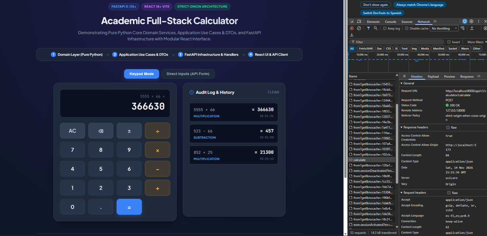
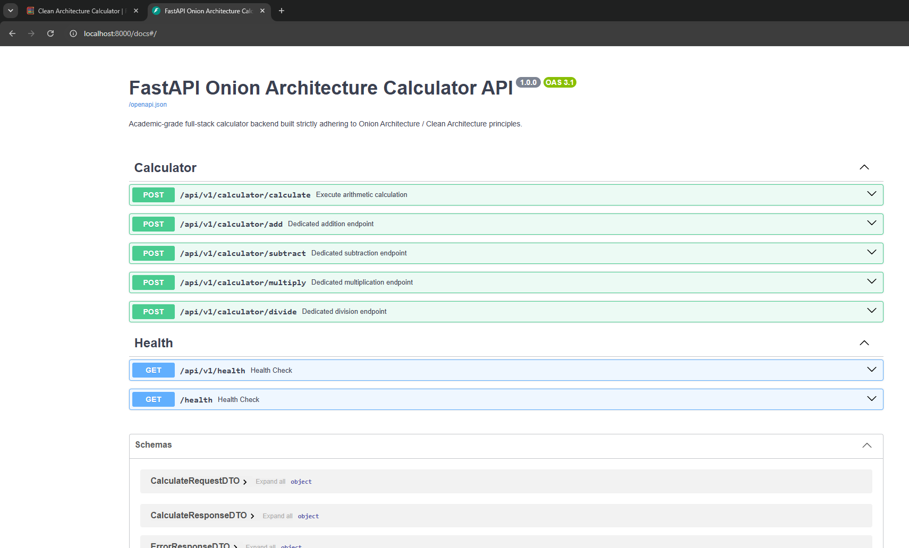

# Onion Architecture Full-Stack Calculator

A clean, robust, and maintainable academic calculator application demonstrating **Strict Onion Architecture** on the backend with **FastAPI** (Python 3.11+) and a **Modular Component Architecture** on the frontend with **React 18**, **TypeScript**, and **Vite**.

---

## 🌟 Key Architectural Highlights

1. **Strict Onion Architecture (Dependency Inversion):**
   - The **Domain Layer** is at the absolute center, implemented in pure Python (standard library only).
   - Zero framework imports (`fastapi`, `pydantic`, database or ORM tools) inside `app/domain/`.
   - Business rules are completely independent of UI, web framework, and persistence mechanisms.

2. **Decoupled Application Layer:**
   - Use Cases (`ExecuteOperationUseCase`) orchestrate domain models and services.
   - Pydantic DTOs enforce strict API schema validation at the system boundary.

3. **Robust Infrastructure Layer:**
   - FastAPI routers mounted at `/api/v1/calculator`.
   - Global exception handlers intercept domain violations (e.g. `DivisionByZeroError`) and convert them into standard `400 Bad Request` JSON responses.
   - CORS middleware enabled for local frontend development.

4. **Modular & Resilient React Frontend:**
   - Component-based structure with clear responsibilities (`Display`, `Keypad`, `DirectInputForm`, `ErrorBanner`, `HistoryList`).
   - Strongly-typed API client (`calculatorApi.ts`) that catches network and domain errors without crashing.
   - Dual interface: an interactive visual keypad AND a direct input form for academic evaluation.

5. **Comprehensive Automated Testing:**
   - Backend: `pytest` with unit tests for Domain/Use Cases and integration tests using FastAPI `TestClient`.
   - Frontend: `vitest` + `React Testing Library` for component and error-flow testing.

---

## 📂 Project Structure

```
Calculator_fastapi/
├── backend/
│   ├── app/
│   │   ├── __init__.py
│   │   ├── domain/                         # Pure Python Core (zero framework imports)
│   │   │   ├── __init__.py
│   │   │   ├── models.py                   # Calculation dataclass, OperationType Enum
│   │   │   ├── exceptions.py               # DivisionByZeroError, InvalidOperationError
│   │   │   └── services.py                 # CalculatorDomainService (business rules)
│   │   ├── application/                    # Use Cases & DTOs
│   │   │   ├── __init__.py
│   │   │   ├── dtos.py                     # CalculateRequestDTO, CalculateResponseDTO
│   │   │   └── use_cases.py                # ExecuteOperationUseCase
│   │   └── infrastructure/                 # External Adapters & Framework Config
│   │       ├── __init__.py
│   │       ├── main.py                     # FastAPI app, CORS, exception handlers
│   │       └── api/
│   │           ├── __init__.py
│   │           ├── exception_handlers.py   # Domain error -> HTTP 400 JSON translation
│   │           └── v1/
│   │               ├── __init__.py
│   │               └── calculator_router.py # REST endpoints (/calculate, /add, etc.)
│   ├── tests/
│   │   ├── conftest.py                     # FastAPI TestClient fixtures
│   │   ├── unit/
│   │   │   ├── test_domain_service.py      # Pure domain tests
│   │   │   └── test_use_cases.py           # Application orchestration tests
│   │   └── integration/
│   │       └── test_calculator_api.py      # HTTP API & exception handler tests
│   ├── requirements.txt
│   ├── pytest.ini
│   └── README.md
│
├── frontend/
│   ├── src/
│   │   ├── components/
│   │   │   ├── Calculator.tsx              # Main container & state manager
│   │   │   ├── Display.tsx                 # Screen component
│   │   │   ├── Keypad.tsx                  # Interactive buttons
│   │   │   ├── DirectInputForm.tsx         # Direct operand inputs for grading/testing
│   │   │   ├── ErrorBanner.tsx             # Structured 400 error banner
│   │   │   └── HistoryList.tsx             # In-memory calculation log
│   │   ├── services/
│   │   │   └── calculatorApi.ts            # Fetch client & custom CalculatorApiError
│   │   ├── types/
│   │   │   └── calculator.ts               # TypeScript DTO models
│   │   ├── App.tsx
│   │   ├── index.css                       # Modern dark-mode responsive design
│   │   ├── main.tsx
│   │   └── setupTests.ts
│   ├── tests/
│   │   └── Calculator.test.tsx             # Vitest & RTL test suites
│   ├── package.json
│   ├── tsconfig.json
│   ├── vite.config.ts
│   └── README.md
│
└── README.md
```

---

## ⚡ Quick Start Guide

### Step 1: Start the Backend (FastAPI)

```bash
cd backend

# Create & activate virtual environment
python -m venv .venv
# On Windows:
.venv\Scripts\activate
# On Linux/macOS:
source .venv/bin/activate

# Install dependencies
pip install -r requirements.txt

# Run backend test suite (20 tests)
pytest -v

# Start FastAPI server on port 8000
uvicorn app.infrastructure.main:app --reload --port 8000
```

FastAPI will be available at:
- API Base: `http://localhost:8000`
- Swagger UI (Interactive Docs): `http://localhost:8000/docs`
- Health check: `http://localhost:8000/health`

### Step 2: Start the Frontend (React + Vite)

In a new terminal window:

```bash
cd frontend

# Install node dependencies
npm install

# Run frontend test suite
npm test

# Start Vite dev server on port 5173
npm run dev
```

Open your browser at:
`http://localhost:5173`

---

## 📋 API Specification Contract

### Endpoint: `POST /api/v1/calculator/calculate`

#### Request Payload
```json
{
  "operand_a": 10.0,
  "operand_b": 2.0,
  "operation": "DIVISION"
}
```
*Valid operations:* `ADDITION`, `SUBTRACTION`, `MULTIPLICATION`, `DIVISION`.

#### Success Response (`200 OK`)
```json
{
  "operand_a": 10.0,
  "operand_b": 2.0,
  "operation": "DIVISION",
  "result": 5.0
}
```

#### Error Response (`400 Bad Request`)
When dividing by zero:
```json
{
  "error": "BAD_REQUEST",
  "message": "Cannot divide by zero",
  "timestamp": "2026-11-13T13:30:00Z"
}
```

---

## 🧪 Testing Summary

- **Backend:** 20 test cases covering domain business rules, domain exceptions, use case orchestration, FastAPI router endpoints, CORS, and HTTP 400 error translation.
- **Frontend:** Vitest + React Testing Library tests covering initial render, addition flow, division by zero domain error handling and banner dismissal, AC clear, and form mode switching.
